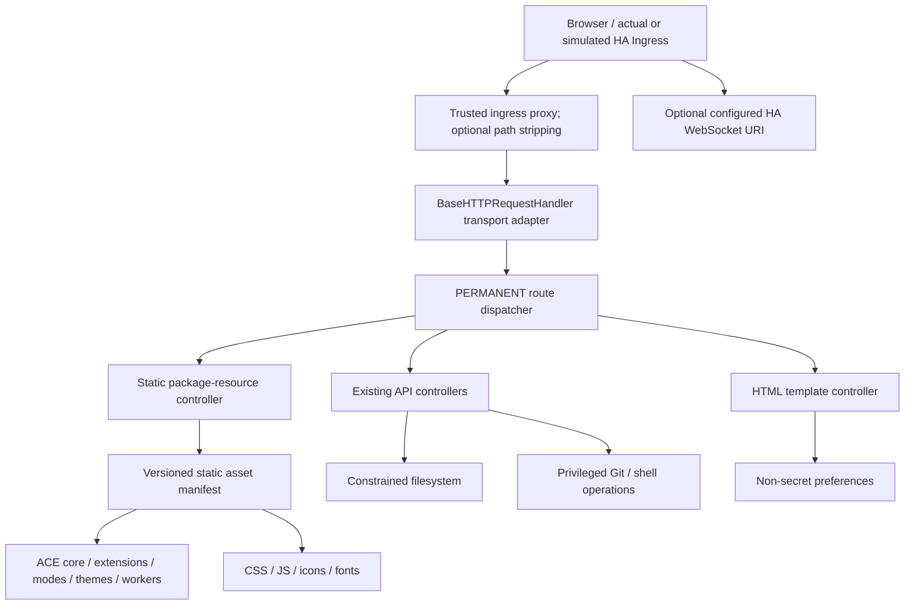

# Offline Architecture — normative target (ADR register)

**Status:** normative proposal for PR #12. Once approved, every implementation PR **MUST** comply or submit an explicit ADR change for review. This documents desired behavior; it does **not** assert current implementation or real HA Ingress verification.

## Context and verified baseline
- `hass_configurator/configurator.py` is a monolithic `BaseHTTPRequestHandler` with `endswith(...)` dispatch. GET handlers include `/api/file`, `/api/download`, `/api/listdir`, `/api/prefs`, config/reload endpoints and static routes; POST includes `/api/save`, `/api/upload`, `/api/exec_command`, Git operations and more.
- `hass_configurator/dev.html` contains extensive inline JavaScript and event-handler attributes. The Home Assistant event observer calls `new WebSocket(document.getElementById("ws_uri").value)`; **this app does not operate its own WebSocket endpoint**.
- `dev.html` uses Ace 1.9.6 script URLs from cdnjs, Materialize CSS 0.100.2 and MDI CSS 3.4.93 from cdnjs, while jQuery 3.6.0, js-yaml, Materialize JS and some fonts are local.
- `setup.py` currently reports 0.6.0 while `hass_configurator/configurator.py` contains 0.7.0; current Dockerfile installs public PyPI code rather than this fork.
- `master` is the implementation base; historical `offline` is not to be merged wholesale.

## Component design

### Permanent router and response boundary — P0, #2
**ADR-003 (revised):** retain `BaseHTTPRequestHandler` only as the initial HTTP transport **adapter**. Extract a **permanent**, testable route dispatcher and common response writer in #2, *not* a temporary asset-only `endswith` branch. A full framework migration and decomposition of UI remain optional P2 work (#11). P1 security controls (#7/#13) must be integrated into the permanent dispatch/authorization/response boundary rather than scattered across raw handlers.

- Dispatch MUST compare **normalized exact routes and methods**, except explicit safe prefixes for static assets; static routes, HTML and `/api/*` MUST be isolated. Preserve existing API compatibility until tests demonstrate a safe migration.
- Route/controller code MUST return a structured response result (status, headers, body/stream) to a single response writer. The transport MUST emit exactly one status line/header section and handle malformed input, 404/405 and exceptions deterministically. Centralize no-store policy and security headers here.
- Resolve static assets via an allowlisted **package manifest**, not request-controlled filesystem paths. Reject traversal and encoded escapes, separators, symlink escapes and directory listings. Authorization for app data MUST be checked independently from static file confinement.
- Avoid introducing an untested blanket rewrite of all existing API behavior in P0. First provide compatible adapters and tests; move mutating handlers to policy-checked route functions in P1.
- P0 tests MUST exercise method separation, route collisions (e.g., `/evil/api/save`), exceptions, repeated/double response headers, malicious paths and ingress.

### Browser base URL and actual HA Ingress — P0/P1, #2/#8
Official HA guidance: [Contributors ingress guide](https://contributors.home-assistant.io/apps/guides/ingress/) and [HA developer docs](https://developers.home-assistant.io/docs/apps/presentation/). Ingress mount paths vary per installation, and its proxy injects `X-Ingress-Path`. The exact live behavior is subject to P1 validation.

1. **Browser-visible base:** use a canonical document directory URL ending in `/` as the base for relative `assets/...` and `api/...`. Confirm handling of a missing trailing slash at the proxy boundary; do not redirect from backend to origin-root `/` when mounted under an opaque prefix.
2. **HTML/static:** HTML and static/script/font URLs MUST resolve under that externally visible directory. The ingress proxy MAY strip the prefix, so internal handlers see normalized `/`, `/assets/...` and `/api/...`; they MUST NOT assume that the external opaque prefix is present internally.
3. **API calls:** frontend code SHOULD use a centralized `new URL('api/...', appBase)` helper and MUST NOT hard-code origin-root `/api/`. Apply to fetch/AJAX, forms, upload, download and Git actions. Existing paths are enumerated in current code and MUST be covered by regression tests.
4. **Redirects and new tabs:** resolve internal redirects relative to application base (or use a correctly configured proxy's rewrite). New tabs MUST retain the ingress prefix and MUST use `noopener` when opening additional content; audit existing `window.location.origin + window.location.pathname` and `window.open('api/download?...')` behavior before changing it.
5. **Ingress header trust:** `X-Ingress-Path` is a **supported HA header**, not intrinsically untrustworthy. Prefer relative browser URLs when sufficient. If a server-rendered absolute URL/base is required, accept a forwarded ingress prefix **only** on traffic from explicitly configured trusted proxy peers and only when the ingress deployment mode is enabled; peers MUST strip/sanitize user-supplied versions before setting it. Validate path syntax, reject control chars, scheme/host and traversal. Direct standalone clients MUST NOT be able to spoof it. P1 real HA ingress tests MUST confirm the supported header semantics and proxy peer restrictions (official docs mention `172.30.32.2`; configure rather than assume a universal address).
6. **WebSocket:** HASS Configurator does **not** serve an app-origin WS. Its only current WS behavior is the optional HA event observer using the configured `ws_uri` / `HASS_WS_API` or derived local HA WS URL. Do **not** invent a `/ws` route or require ingress WebSocket routing. The configured endpoint MUST be explicitly validated and approved in CSP/connect-src and network-allowlist tests, and its failure MUST NOT prevent local editing.
7. **Acceptance split:** **P0:** simulated ingress with prefix stripping plus root mode, API/static, redirects, new tabs and HA WS URL behavior. **P1:** an actual HA OS add-on/Ingress deployment and trace showing the same behavior. A simulated prefix is not proof of real HA support.

### Asset provenance and resolution — P0, #1/#3
**ADR-006:** candidate single authoritative source for initial Ace bundle is the upstream `ace-builds@1.9.6` npm release tarball, using the **`src-min-noconflict`** build family. `ace-builds` contains distinct `src`, `src-min`, `src-noconflict` and `src-min-noconflict` variants; do not mix families or fetch extensions/workers independently from CDNs. #1 MUST verify tarball availability, integrity and compatibility; #3 MUST record any justified alternative in a new ADR.

- Capture official package name, exact version, resolved immutable tarball URL, package-provided `dist.integrity` and per-file SHA-256 in a checked-in machine-readable lock/manifest. No unverified downloaded file is accepted at build time. Preserve license/NOTICE.
- Source layout MUST retain `ace.js`, `ext-modelist.js`, `ext-language_tools.js`, actually referenced `mode-*.js`, `theme-*.js`, `keybinding-*.js`, `worker-*.js` and any transitive dependencies in the **same** family. Determine required closure from HTML choices plus browser network traces; test mode/theme switches and workers.
- Asset paths are derived from a versioned static base, including `ace.config.set('basePath', ...)`, `modePath`, `themePath`, `workerPath`. Avoid hidden dependence on cdnjs or mixed-version files.
- All future upgrades MUST update the lock, license listing, asset closure test and offline smoke in one PR.

### Cache-busting and response policy — P0, #2/#5/#6
**ADR-009:** use **content-addressed versioned asset URL prefix** `assets/v<manifest-digest>/...` (e.g. the first 12+ hex characters of a SHA-256 manifest digest; exact length and collision policy defined in #2). Names may remain `ace.js` / `worker-yaml.js` *inside* the versioned tree. Do not use fixed asset URLs with long-lived caching or rely solely on `?v=...`.

| Resource | Cache policy | Extra controls |
| --- | --- | --- |
| Fingerprinted static JS/CSS/fonts/worker scripts | `Cache-Control: private, max-age=31536000, immutable` | `Content-Type`, `X-Content-Type-Options: nosniff`; served from package only; avoid shared-proxy cache of ingress-token URLs |
| HTML/bootstrap, auth/session-aware redirects, error pages | `Cache-Control: no-store` | Never expose ingress tokens or HA credentials to shared caches |
| `/api/*` including file payload, edits, preferences, privileged ops | `Cache-Control: no-store` | Authorization, content type, no cache of secrets |
| Unversioned compatibility static endpoints (if temporarily retained) | `Cache-Control: no-cache, must-revalidate` | Remove after consumers migrate; no immutable claim |

- A new build MUST get a new digest if any bundled byte or the asset map changes; all generated references including Ace lazy-loading MUST use the new digest.
- The HTML entry MUST resolve the *current* digest. Reloading after add-on upgrade MUST fetch a new HTML entry and new asset set; cold-cache and warm-cache upgrades must both be tested under simulated ingress.
- Already-open pages may reference an old asset set after in-place upgrade. Define deterministic recovery (reload prompt or maintained old assets for a rolling update); never silently load a different build's worker and script. Document HA add-on restart behavior.
- Optional ETag/304 for immutable assets is allowed but not necessary; security header tests MUST verify no-store for sensitive responses.
- Tests MUST cover version change, identical-build stability, correct MIME, root/prefix URLs and zero stale asset usage after reload.

### CSP and frontend migration — P1, #13
**ADR-008:** CSP is owned by [#13](https://github.com/undel-gh/hass-configurator/issues/13) alongside [#7](https://github.com/undel-gh/hass-configurator/issues/7) security review. The current inline scripts and inline handlers make immediate strict `script-src 'self'` infeasible. An honest staged plan is mandatory:
- inventory execution surfaces, report-only violations and legitimate Ace workers / HA WS in a test matrix;
- migrate the **minimum security-blocking inline JS and event handlers in P1** as required for an enforceable policy. Broad frontend refactoring remains P2, not a reason to defer P1 security indefinitely;
- review `default-src`, `script-src`, `style-src`, `font-src`, `img-src`, `worker-src`, `connect-src`, `base-uri`, `object-src` and ingress framing policy;
- test under actual HA Ingress and standalone; no silent acceptance of `unsafe-inline`/`unsafe-eval` as “hardened.” Residual exceptions or unenforced directives require explicit release-risk disposition, owner and follow-up, not a hidden waiver.

### External network policy
**ADR-002:** all browser-initiated runtime requests during supported scenarios MUST be to the application's own origin or explicitly approved local/LAN HA REST/WS. Any attempted public-origin fetch MUST fail CI even if unsuccessful/fallback, including worker/CDN/font/image requests. Opening external documentation by a deliberate user action is an explicit exception; no automatic prefetch.

## ADR register and change governance

| ADR | Decision | Owner / verification |
| --- | --- | --- |
| ADR-001 | Base implementation on `master`; review historical offline branch selectively | #1, PR review |
| ADR-002 | No external-origin fetch attempts during normal runtime | #6/#14, browser attempt tracing |
| ADR-003 | Permanent router/response boundary in P0, transport adapter retained | #2/#7, HTTP tests |
| ADR-004 | Relative root/ingress URLs + trusted header policy | #2/#8, simulated and real ingress |
| ADR-005 | Security-sensitive API changes have abuse/regression tests | #7, CI |
| ADR-006 | One pinned, intact Ace build family from authoritative artifact | #1/#3, lock integrity + E2E |
| ADR-007 | Normative docs and PR requirement-test traceability | #14, required review checklist |
| ADR-008 | Staged CSP with explicit decision owner | #13/#7, policy tests |
| ADR-009 | Fingerprinted assets, explicit per-resource cache headers | #2/#5/#6, upgrade/cache tests |

**Change rule:** altering a normative ADR MUST update `docs/ARCHITECTURE.md`, `docs/SPECIFICATION.md`, `docs/TRACEABILITY.md`, relevant issues and test evidence in the same PR. Document exceptions by expiry and responsible issue.

## Remaining security threats
Filesystem root bypass, symlink/TOCTOU, unauthorized state-changing actions and CSRF, unsafe command/Git privileges, XSS/HTML interpolation, untrusted forwarded headers, leakage of API tokens, stale ingress caching, supply-chain drift and silent CDN fetches. P0 MUST NOT introduce new vulnerabilities; P1 release is blocked by unresolved high-severity findings.

## PR #18: P0 distribution identity and offline container contract

Packaging/runtime identity is now a single value in
`hass_configurator/_version.py`, parsed by `setup.py` without runtime
imports and imported by `configurator.py`. The UI About dialog and
read-only `GET /api/version` report this same value; all dynamic
HTML/API responses remain `Cache-Control: no-store`. The *resource URL*
fingerprint under ADR-009 remains a digest of packaged asset bytes,
**independent of the software version number**.

The main Dockerfile must build a wheel from **this fork's checkout**, install
that wheel into the runtime image, and never implicitly substitute a
same-named public PyPI release. The CI release gate checks a local-networkless
container boot and a real browser loading/editing from the fork container.
Wheel/sdist/Docker asset bytes, package version and fingerprint must agree.

This does **not** certify image bit-for-bit reproducibility across build
dates: base-image digests and transitive build/runtime dependencies require
separate verified immutable locks (#5/#9). Nor does it certify external
Supervisor Ingress or protect legacy privileged endpoints (#8/#7/#13).
