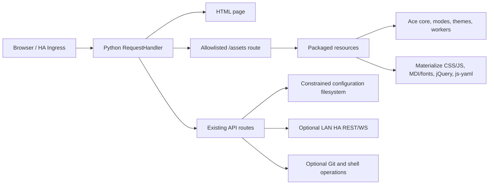

# Offline Architecture

Status: proposed; retain Python HTTP server initially.

## Existing topology
- `hass_configurator/configurator.py`: monolithic BaseHTTPRequestHandler, API operations, HTML rendering and repeated `endswith` static routes.
- `hass_configurator/dev.html`: combined HTML + large inline JS; loads Ace 1.9.6 and extensions, Materialize 0.100.2 CSS and MDI 3.4.93 CSS from cdnjs.
- `hass_configurator/{jquery-3.6.0.min.js,js-yaml.min.js,materialize.min.js,style.css,material-icons.fallback.css,*.woff2}`: partially-localized assets already in `master`.
- `MANIFEST.in` names a few local assets; `Dockerfile` installs generic PyPI `hass-configurator` rather than fork source.
- Root-level `configurator.py` and `dev.html` are parallel historical copies; identify actual consumers before changing or removing.

## Target boundaries
**Build time:** verified pinned upstream archives → offline asset vendor tree → hash/licenses/SBOM → complete wheel/sdist/image. Network can be used for controlled build-time dependency download; never needed for browser runtime.

**Browser runtime:** relative same-origin URLs, styles, icons, fonts and Ace lazy-loaded scripts all from package. Explicit Ace `basePath`, `modePath`, `themePath`, `workerPath`; URLs adapt to ingress prefix.

**HTTP static route:** allowlisted package resource namespace (suggest `assets/`), strict URL parsing, safe path normalization and MIME. Keep separate from `/api/*` and file editing endpoints, prohibit traversal, avoid double response headers and leaking config files.

**Application API:** preserve existing file read/write/management and local HA REST/WS interactions. Harden authorization, path confinement, CSRF and privileged shell/Git actions in P1; address any critical blockers found sooner.

**Deployment:** standalone Python wheel, fork-built Docker container, optionally downstream official/community HA OS add-on packaging. Do not mistake a Python fork release for an updated official add-on.

## ADRs
- ADR-001: implement on `master`, selectively port ideas from divergent `offline`.
- ADR-002: never rely on CDN or dynamic Internet runtime downloads.
- ADR-003: avoid full HTTP framework/UI rewrite until after verified offline MVP.
- ADR-004: preserve relative ingress paths and root deployment.
- ADR-005: security-sensitive API changes require independent regression tests.

## Threats and controls
Path traversal (including encoded forms), symlink escape, TOCTOU, unauthorized mutating requests, secrets injected into HTML, XSS, permissive proxy trust, unsafe command/Git operations and library supply-chain risk. No arbitrary filesystem paths in static serving; least-privilege runtime. CSP restricted to self where compatible, with explicit optional LAN HA connect origin. Existing inline JS may require a staged CSP migration; do not claim strict CSP until verified.
