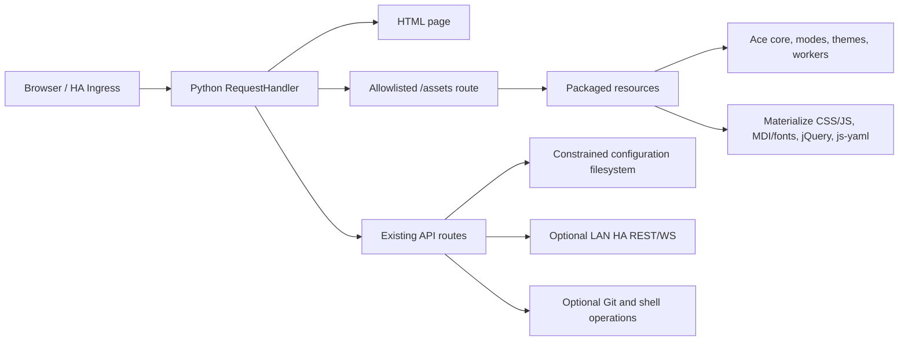

# Offline Architecture

Status: proposed; retain Python HTTP server initially.

## Existing topology
- `hass_configurator/configurator.py`: monolithic BaseHTTPRequestHandler, API operations, HTML rendering and repeated `endswith` static routes.
- `hass_configurator/dev.html`: combined HTML + large inline JS; loads Ace 1.9.6 and extensions, Materialize 0.100.2 CSS and MDI 3.4.93 CSS from cdnjs.
- `hass_configurator/{jquery-3.6.0.min.js,js-yaml.min.js,materialize.min.js,style.css,material-icons.fallback.css,*.woff2}`: partially-localized assets already in `master`.
- `MANIFEST.in` names a few local assets; `Dockerfile` installs generic PyPI `hass-configurator` rather than fork source.
- Root-level `configurator.py` and `dev.html` are parallel historical copies; identify actual consumers before changing or removing.

## Target boundaries
**Build time:** verified pinned upstream archives → offline asset vendor tree → hash/licenses/SBOM → complete wheel/sdist/image. Network can be used for controlled build-time dependency download; never needed for browser runtime.

**Browser runtime:** resolve same-origin URLs for HTML, CSS/JS/fonts, API operations and Ace lazy-loaded resources from a canonical application base. Explicit Ace `basePath`, `modePath`, `themePath`, `workerPath`. Avoid root-absolute paths that would escape a Home Assistant ingress prefix.

**HTTP static route:** allowlisted package resource namespace (suggest `assets/`), strict URL parsing, safe path normalization and MIME. Keep separate from `/api/*` and file editing endpoints, prohibit traversal, avoid double response headers and leaking config files.

**Application API:** preserve existing file read/write/management and local HA REST/WS interactions. Harden authorization, path confinement, CSRF and privileged shell/Git actions in P1; address any critical blockers found sooner.

**Deployment:** standalone Python wheel, fork-built Docker container, optionally downstream official/community HA OS add-on packaging. Do not mistake a Python fork release for an updated official add-on.

## Home Assistant Ingress URL and proxy contract (P0 design)

The following is the **target design**, not a claim of verified HA OS behavior. Confirm the actual Supervisor ingress path rewriting and forwarded-header set during P1 real-add-on tests.

1. **External mount:** the browser sees an opaque prefix such as `https://ha.example/api/hassio_ingress/TOKEN/`. A reverse proxy may strip that prefix before forwarding requests to the Python app; the backend sees `/`, `/assets/...`, or `/api/...`. It must not assume that its request path contains the external prefix or compare the externally visible `/prefix/assets/...` with an internal `/assets/...` verbatim.
2. **Canonical HTML base:** generate relative references from the current canonical directory URL, ending with `/`. For the base page, use no root-relative asset/API URLs. A no-slash entry URL must be redirected to its slash-terminated **external** equivalent by the responsible reverse proxy, or the frontend must derive the correct directory base before loading relative assets; never issue a backend redirect to `/` that discards the external prefix. Verify that both direct navigation and refresh work. Avoid relying on `<base>` until its effects on fragment links, anchor navigation and downloads are tested.
3. **Static assets:** from the canonical page URL, use relative `assets/...`; CSS `url(...)` is relative to the stylesheet location. Ace module/worker paths are explicit URLs constructed from that same base (`assets/ace/...`) rather than implicit CDN/default paths. They remain prefixed in the browser, even if the proxy strips that prefix at the backend.
4. **Application APIs:** centralize URL construction using `new URL('api/...', applicationBase)` or equivalent, consistently for GET, POST, upload, download and file navigation. Do not call root-absolute `/api/*`. Route internal `/api/*` separately from `/assets/*` after the proxy's path translation.
5. **Redirects and new tabs:** internal response `Location` should be relative to the current external base (or be rewritten by a trusted ingress proxy). Open new tabs with URLs derived from the same application base; use `noopener`/`noreferrer` as applicable. Do not generate origin-root URLs or leak access tokens in external links. Explicit external documentation navigation is an exception to offline network policy only upon user action.
6. **WebSockets:** distinguish (a) optional Home Assistant API observer on a separately configured LAN endpoint from (b) any WebSocket served by this app through ingress. For (b), derive the `ws:` or `wss:` URL from the browser-visible `applicationBase`, preserving the external prefix. For (a), use the configured approved HA WS URL and no fallback to a public endpoint; WebSocket connection failure must not block local editing.
7. **Prefix ownership / headers:** preferred mode is relative URL construction plus proxy path-strip semantics, **not** accepting arbitrary client `X-Ingress-Path`. If tests prove a trusted forwarded prefix is required for a response (e.g. absolute redirect), allow it only behind an explicitly configured, authenticated/trusted reverse proxy that strips client-supplied variants and injects a verified value; validate prefix syntax and never accept it from arbitrary direct clients. Otherwise omit such headers entirely. Document proxy/IP trust boundary and test spoofed headers.
8. **Two acceptance gates:** **P0** simulated prefix reverse proxy + missing-slash, API, assets, redirect, new tab, and applicable WS tests; **P1** actual Home Assistant add-on ingress with browser devtools/netlog and compatible HA API behavior. These are distinct checks, not interchangeable.

## Offline network policy
Any attempted browser runtime request to a public external origin is a failure during supported scenarios—even a failed/nonblocking CDN fallback. Explicit user-opened external documentation links and explicitly allowlisted local/LAN HA REST/WS are the only exceptions; capture attempted requests and exceptions in E2E artifacts. Start a minimal smoke with static route work (#2), extend alongside #3–#5, finalize in #6.

## ADRs
- ADR-001: implement on `master`, selectively port ideas from divergent `offline`.
- ADR-002: never rely on CDN or dynamic Internet runtime downloads.
- ADR-003: avoid full HTTP framework/UI rewrite until after verified offline MVP.
- ADR-004: preserve relative ingress paths and root deployment.
- ADR-005: security-sensitive API changes require independent regression tests.

## Threats and controls
Path traversal (including encoded forms), symlink escape, TOCTOU, unauthorized mutating requests, secrets injected into HTML, XSS, permissive proxy trust, unsafe command/Git operations and library supply-chain risk. No arbitrary filesystem paths in static serving; least-privilege runtime. CSP restricted to self where compatible, with explicit optional LAN HA connect origin. Existing inline JS may require a staged CSP migration; do not claim strict CSP until verified.
