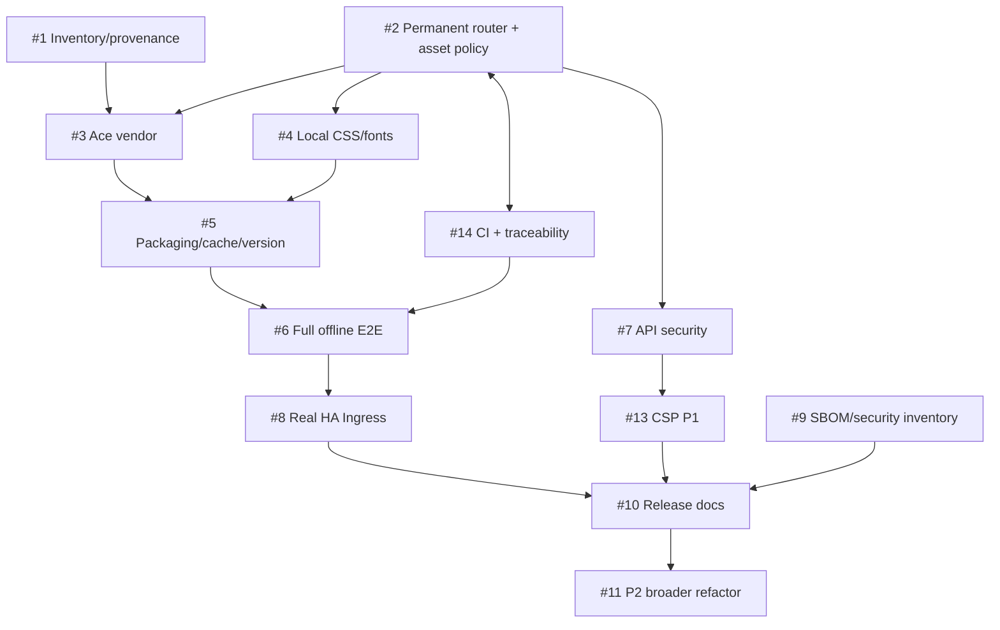

# HASS Configurator — Project Map (normative ownership)

**Status:** original architectural map from PR #12, followed below by the actual P0 implementation map (PRs #15/#16). Paths in the conceptual tree remain illustrations rather than claims that exact directories exist. Owners are GitHub Issues, not individual maintainers.

## Current source map

| Path | Current role (observed) | Required change / Issue |
| --- | --- | --- |
| `hass_configurator/configurator.py` | `BaseHTTPRequestHandler` for HTML, GET/POST APIs, auth, static routes | Permanent exact/method-aware dispatcher and response writer in #2; audited P1 auth/CSRF/filesystem in #7 |
| `hass_configurator/dev.html` | HTML, inline JS, handlers, editor settings and HA observer WS | Same-origin assets and URL base (#3/#4); CSP-blocking inline extraction (#13), broad modularization (#11) |
| `hass_configurator/style.css` | UI themes/styles | CSS/font audit (#4), cache fingerprinting (#2/#5) |
| `hass_configurator/jquery-3.6.0.min.js` | Local jQuery | Manifest/version inventory (#1/#9) |
| `hass_configurator/js-yaml.min.js` | Local YAML parser | Inventory, preserve YAML diagnostics (#1/#6) |
| `hass_configurator/materialize.min.js` | Local Materialize UI JS | Match local stylesheet (#4), license review (#9) |
| `hass_configurator/material-icons.fallback.css` and `*.woff2` | Local icon/font fallback | Audit font coverage, license, MIME and cache (#4/#5) |
| `MANIFEST.in`, `setup.py` | Package assets/version currently not unified | Full wheel/sdist, single version authority, file hashes (#5) |
| `Dockerfile` | Uses published PyPI package | Install fork artifact rather than unrelated PyPI release (#5) |
| `configurator.py`, `dev.html` at repo root | Historical alternate sources | Find consumers before cleanup (#1/#11) |
| `.travis.yml` | Legacy CI configuration | Add maintained GitHub Actions baseline (#14) |
| `settings.conf` / `start.sh` | Standalone configuration and lifecycle | Document security and rollout compatibility (#7/#10) |

### Proposed structure (implementation not started)

```text
hass_configurator/
  configurator.py              # existing entry point/transport adapter
  http/                        # planned in #2; permanent
    routing.py                 # exact path + method dispatch, policy hooks
    responses.py               # central status, headers, body/stream writer
    assets.py                  # package manifest only, path guard, cache policy
  static/
    v<manifest-digest>/
      ace/src-min-noconflict/   # ace.js, ext-*.js, mode/theme/worker scripts
      materialize/
      mdi/
      fonts/
  assets-manifest.json          # pinned source + integrity + individual hashes
scripts/
  vendor_assets.py             # deterministic vendoring (planned #1/#3/#5)
tests/
  test_routing.py              # planned #2
  test_static_assets.py        # planned #2
  test_api_security.py         # planned #7
  test_packaging.py            # planned #5
e2e/
  offline.spec.*               # planned #2/#6/#14; must observe request attempts
  ingress.spec.*               # planned #2 P0, #8 P1 real deployment evidence
  cache-upgrade.spec.*         # planned #5/#6
.github/
  workflows/                   # planned GitHub Actions #14
  pull_request_template.md     # process template added in documentation PR
docs/
  ROADMAP.md
  SPECIFICATION.md
  ARCHITECTURE.md
  PROJECT_MAP.md
  TRACEABILITY.md
```

The above is a **conceptual ownership map**, not a mandate to create every listed module immediately. #2 MUST create a *permanent* testable router/response abstraction; exact filenames may change with ADR update. No new WebSocket server module is planned because current WS client targets Home Assistant.

## Workstream dependencies



## Responsibility / gates

| Boundary | Contract | Primary Issues | Verification |
| --- | --- | --- | --- |
| Route+response boundary | Permanent exact/method dispatcher, single status/headers writer | #2 / #7 | AT-05, AT-07 |
| App URL and HA ingress | Prefix-correct HTML/asset/API/redirect/new tab; trusted X-Ingress-Path | #2 / #8 | AT-05 simulated, AT-11 real |
| HA WS observer | External configured HA WS client only; failure nonblocking | #8 | AT-06, AT-11 |
| Versioned asset supply chain | Single pinned Ace artifact family, complete modules/workers/fonts | #1/#3/#4/#9 | AT-01, AT-03, AT-08 |
| Caches/releases | Fingerprinted URL, immutable assets, no-store HTML/API | #2/#5/#6 | AT-09 |
| Test and governance | GH Actions, requirement coverage, PR template | #14/#6 | AT-10 |
| App security and CSP | Path confinement, CSRF/auth, CSP migration, explicit risk decision | #7/#13 | AT-12 |
| Documentation | Normative FR/NFR/ADR, synchronized on each PR | #14/#10 | TRACEABILITY review |

## Process rules
1. Every PR MUST list impacted FR/NFR/ADR IDs, owner Issues, tests and their evidence. A doc or code change is incomplete if traceability is not updated or explicitly marked N/A with reason.
2. All state is recorded as `pending` until tests/CI or reproducible manual artifacts exist. This documentation PR does not satisfy runtime release gates.
3. P0 supports a **simulated** ingress prefix; P1 MUST test a real HA OS app/Ingress. A simulated proxy may not accurately reproduce `X-Ingress-Path`, so log and compare actual request headers during P1.
4. Architectural deviations MUST update the ADR register and corresponding contract, acceptance test and issue in one PR.

## References
- [Offline roadmap](ROADMAP.md)
- [Requirements and acceptance matrix](SPECIFICATION.md)
- [Architectural decisions](ARCHITECTURE.md)
- [Traceability register](TRACEABILITY.md)
- [Issues](https://github.com/undel-gh/hass-configurator/issues)
- [Home Assistant Ingress guide](https://contributors.home-assistant.io/apps/guides/ingress/)

## Actual P0 implementation map (PR #15 / PR #16)

| Actual path | Status and responsibility |
| --- | --- |
| `hass_configurator/http_routing.py` | **Implemented** permanent exact-method route dispatcher, single response writer for static/errors, manifest-backed nested asset allowlist, checksum and symlink checks, startup digest snapshot |
| `hass_configurator/vendor/manifest.json` | **Implemented** immutable source SRI/tarball SHA-256 plus per-resource SHA-256 for all 460 Ace/CSS/icon/font/license files |
| `hass_configurator/vendor/ace/` | **Implemented** 440 pinned `ace-builds@1.9.6` `src-min-noconflict` files including dynamic workers/snippets |
| `hass_configurator/vendor/materialize/` | **Implemented** Materialize 0.100.2 stylesheet and all referenced Roboto font files |
| `hass_configurator/vendor/mdi/` | **Implemented** Material Design Icons 3.4.93 stylesheet and all five referenced font formats |
| `hass_configurator/vendor/licenses/` | **Implemented** upstream Ace, Materialize and MDI license texts; full downstream SBOM and Roboto license review remain #9 |
| `scripts/vendor_offline_assets.py` | **Implemented** reproducible npm tarball importer and byte-exact `--verify-only` CI gate; runtime never downloads files |
| `scripts/check_offline_artifacts.py` | **Implemented** wheel and sdist byte-exact vendor manifests verification; Docker and unified version source remain #5 |
| `tests/test_vendored_assets.py` | **Implemented** unit checks for hash closure, URL/MIME, CSS font dependencies, missing/tampered resources |
| `e2e/offline-dynamic.spec.cjs` | **Implemented** cold-cache browser tests for dynamic Ace mode/theme/keybindings, YAML worker diagnostics and local MDI/Roboto fonts |
| `e2e/offline-smoke.spec.cjs` | **Implemented** strict zero-public-origin request attempts for root and simulated HA Ingress HTML |
| `.github/workflows/offline-foundation.yml` | **Implemented** pinned runtime / browser tests, npm archive checks, wheel+sdist contents; real HA OS Ingress remains #8 |

The one-time vendor-download workflow was removed after generating the pinned binary commit. The generator remains available for reviewed dependency updates. The existing `BaseHTTPRequestHandler` legacy API controllers have **not** been migrated to new security policies; #7 retains ownership.
